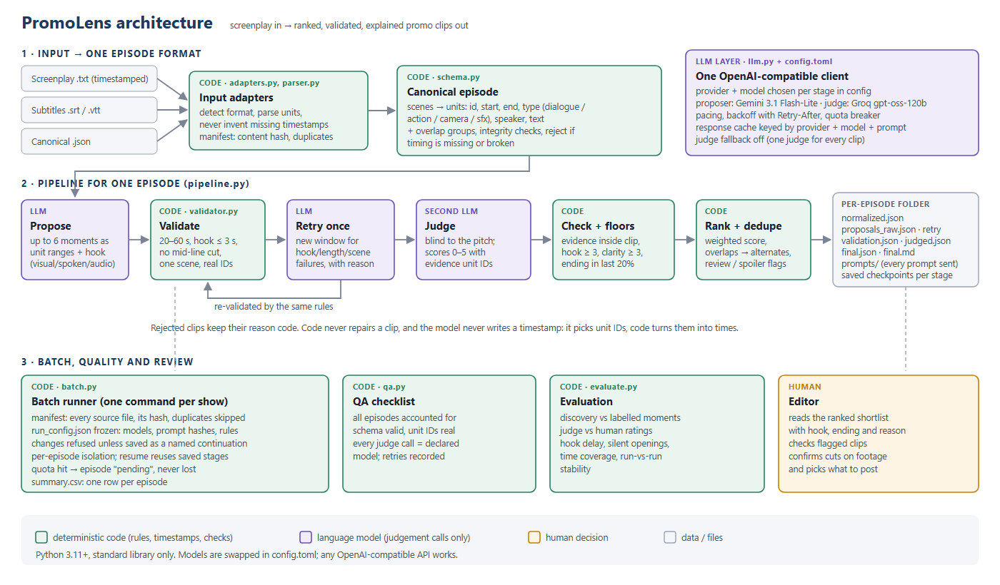

# PromoLens

PromoLens reads the screenplay of a vertical microdrama and finds the moments that would work as **20–60 second promos**
for TikTok, Instagram or YouTube. For every promo it gives the episode, the exact start and end time, the hook, the
ending and one line on why it works, ranked from strongest to weakest.

It was built for the Kuku AI Generalist assignment (Problem 1: Find the Promos).

- **Input:** timestamped screenplays (also subtitles or JSON).
- **Output:** a ranked, explained shortlist per episode, plus a summary sheet for the whole show.
- **Who decides:** a language model picks the story moments, plain code checks every rule, a second model judges
  quality, and an editor makes the final call.

## Architecture



([SVG version](docs/architecture.svg))

## How it works

| Step | Done by | What happens |
|---|---|---|
| 1. Parse | code | The script becomes a list of *units* (a line of dialogue, an action, a camera shot, a sound effect), each with an ID, start time, end time, type and speaker. |
| 2. Propose | LLM | The proposer reads the whole episode and suggests up to 6 promo windows. It answers with **unit IDs only**, never timestamps, and names the hook unit and whether the hook is visual, spoken or audio. |
| 3. Validate | code | Each window is checked: 20–60 s long, hook starts within 3 s, no cut through a spoken line or an overlapping exchange, stays in one scene, all IDs real. A failing window is rejected with a reason code. It is never "fixed" by code. |
| 4. Retry once | LLM | Windows that failed on length, hook or scene get **one** new proposal, with the exact failure reason. The new window goes through the same checks. |
| 5. Judge | second LLM | A separate model scores each valid clip (hook, clarity, emotion, escalation, ending) from 0–5. It never sees the proposer's pitch, and it must cite the unit IDs behind each score. |
| 6. Rank | code | Code checks that the cited units are inside the clip, applies hard floors (hook ≥ 3, clarity ≥ 3), computes a weighted score, merges near-duplicates, and adds flags (needs review, possible spoiler). |
| 7. Approve | editor | The editor reads the ranked shortlist and confirms the cuts on the actual footage. |

### Main design choices

- **The model never writes a timestamp.** It picks unit IDs; code turns them into times. Every timestamp can be traced
  back to a line in the script.
- **Rules live in code, judgement lives in the model.** Duration, hook timing and clean cuts are checked
  deterministically, so they behave the same way on every run.
- **Visual hooks count.** In this kind of show much of the drama is written in camera directions (a fire, a reveal, a
  door opening). The hook can be a camera or action unit, not only a spoken line.
- **Silence is not an error.** A stretch with only camera shots is treated as visual storytelling. A gap where nothing
  at all is scripted is flagged for review, not rejected.
- **One judge for every clip.** The judge model has no automatic fallback, so all scores in a run come from the same
  model and can be compared.
- **Nothing is lost on failure.** Each episode runs on its own, each stage is saved as a checkpoint, and a rerun only
  redoes the stages that failed or changed.

## Quick start

Requirements: **Python 3.11+**. No packages to install; it uses only the standard library.

```bash
git clone <this repo>
cd promolense
cp .env.example .env        # then add your Gemini and Groq API keys
```

Put the episode scripts in `episodes/` (not included in this repo; see *Data* below). Then:

```bash
# check the API keys work (one tiny call)
PYTHONPATH=src python -m promolense hello

# one episode
PYTHONPATH=src python -m promolense run "episodes/episode-001.txt" --out outputs/ep01

# a whole show: every script in episodes/
PYTHONPATH=src python -m promolense batch --out outputs/batch_001

# QA checklist for a finished batch
PYTHONPATH=src python -m promolense qa outputs/batch_001
```

On Windows PowerShell, set the path first with `$env:PYTHONPATH = "src"`, then run the same commands without the
`PYTHONPATH=src` prefix.

If a batch stops (crash, rate limit, daily quota), run the same `batch` command again. Finished episodes are skipped
and saved stages are reused.

Other useful commands (`python -m promolense --help` lists them all):

| Command | What it does |
|---|---|
| `parse <file>` | Parse one script and print unit counts (no model calls). |
| `normalize <file> --out x.json` | Show exactly what the pipeline will see for any input format. |
| `manifest episodes/` | List every input file with its episode number, content hash and duplicate status. |
| `rejudge <run> <new_dir>` | Re-score an earlier run's clips with the current judge model (no new proposals). |
| `discovery --runs <batch_dir>` | Check how many hand-labelled moments were found. |
| `review-summary` | Compare human ratings of clips with the judge's scores. |

## Output

`batch` writes one folder per episode, plus files for the whole show:

```
outputs/batch_001/
├── summary.csv              one row per episode: status, clips found, best score, run time, tokens, errors
├── manifest.csv             every input file, its episode number, content hash, duplicate status
├── run_config.json          the frozen setup for this batch: models, prompt hashes, rules, input hashes
├── qa_report.json           written by the qa command
└── episode_001/
    ├── final.md             the ranked promos, easy to read
    ├── final.json           the same with every field: segments, hook, ending, scores, evidence, flags
    ├── normalized.json      the parsed episode
    ├── proposals_raw.json   what the proposer returned
    ├── validation.json      every proposed window and why it passed or failed
    ├── judged.json          the judge's raw answers
    └── prompts/             every prompt that was sent
```

Each promo in `final.json` includes: the episode, start and end of every segment, the hook unit and how long until it
lands, the ending type (cliffhanger, payoff, emotional resolution or transition), the judge's scores with evidence
unit IDs, the proposer's one-line reason, a review status, and any alternate cuts of the same moment.

## Input formats

All inputs are converted into one episode format (`src/promolense/schema.py`) before the pipeline sees them.

| Format | How it is read | Notes |
|---|---|---|
| Screenplay `.txt` | `parser.py` | Scene headings, `**SPEAKER (tone):**` blocks, `Start: (mm:ss.ss) \| End: (mm:ss.ss)` lines. V.O. and O.S. are kept as modifiers. |
| Subtitles `.srt` / `.vtt` | `adapters.py` | Dialogue only. Visual content is marked as unknown, so gaps are never called "dead air". |
| Canonical `.json` | `schema.py` | The same format the pipeline uses internally; useful for custom inputs. |

Scripts with no timestamps are rejected with a clear message. PromoLens never guesses times.

## Configuration

Everything that can change between shows or providers is in `config.toml`:

- `[providers.*]` and `[stages.*]`: which provider and model each stage uses. Any OpenAI-compatible API works; swap a
  model by editing one line. Defaults: proposer **Gemini 3.1 Flash-Lite**, judge **Groq gpt-oss-120b**.
- `[rules]`: promo length (20–60 s), hook window (3 s), whether a promo may cross scenes.
- `[floors]` and `[weights]`: the quality gates and the ranking weights.
- `[retry]`: which failure types get one re-proposal.

A batch saves its setup in `run_config.json`. If the config changes in the middle of a batch, the run refuses to
continue unless the change is saved as a named continuation (`--continuation NAME`), so every result can be traced to
the exact setup that produced it.

## Results (30-episode evaluation)

Measured on episodes 1–30 of the provided show, using free tiers only:

- **46 promo clips** passed every check (3 flagged for review); 4 episodes produced no clip that passed.
- **35 of 46** clips open on a visual hook.
- All clips were scored by the same judge model. The QA check found no schema errors and no invalid unit references.
- About **4 model calls, 14k tokens and 45 seconds per episode**.
- On a 5-episode test set with 16 hand-labelled strong moments, the pipeline found **12 of 16**.

This is a 30-episode sample, not the whole show: the free judge tier allows about 200k tokens a day (roughly 30
episodes). Episodes 31–49 were proposed and validated, and their judging resumes with the same `batch` command.

## Tests

```bash
python -m unittest discover -s tests
```

130 tests cover parsing, every validation rule, the retry round, judge checks, ranking, rate limits and quota
handling, checkpoints and resume, and QA. Tests that need the real scripts skip themselves when `episodes/` is missing.

## Project layout

```
src/promolense/
  parser.py      screenplay → units
  adapters.py    input formats, format detection, manifest
  schema.py      the episode format and its integrity checks
  validator.py   all structural rules (pure code)
  prompts.py     proposer, retry and judge prompts
  llm.py         one client for any OpenAI-compatible API: pacing, retries, cache
  pipeline.py    propose → validate → retry → judge → rank for one episode
  batch.py       many episodes: manifest, frozen config, resume, summary
  qa.py          QA checklist
  evaluate.py    discovery, ratings vs judge, run comparisons
tests/           unit tests
docs/            architecture diagram
config.toml      models, rules, weights
```

## Known limits

- It reads the script only. It cannot see acting, music or how a shot looks, and script timing may drift from the
  final cut, so the editor confirms on footage.
- Judge scores tend to bunch between 3 and 4, so treat the order within one episode as tiers rather than a strict ranking.
- It sometimes trims long dialogue scenes too short and misses them.
- Variety is reported, not enforced: one episode can produce two clips of the same scene.

## Data

The episode scripts are confidential and are **not** in this repository. `episodes/`, `outputs/` and `eval/` are
git-ignored because they contain script text. API keys go in `.env`, which is also git-ignored.
